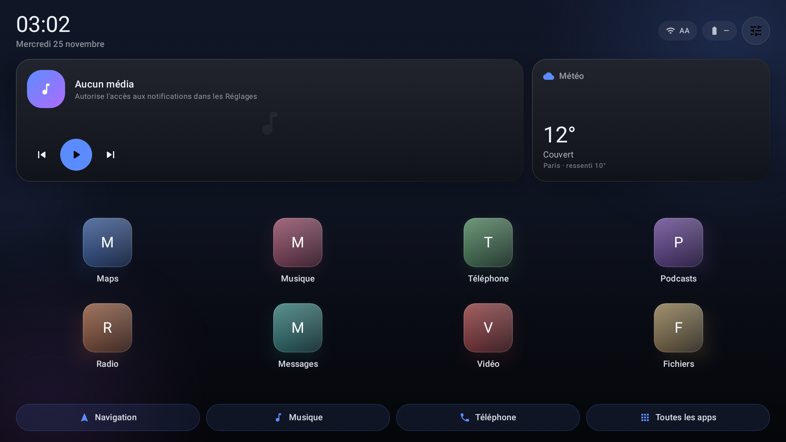
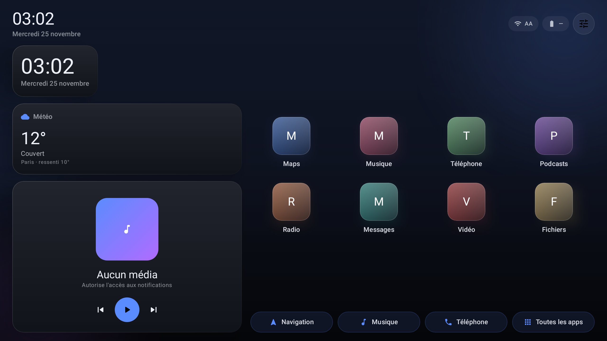
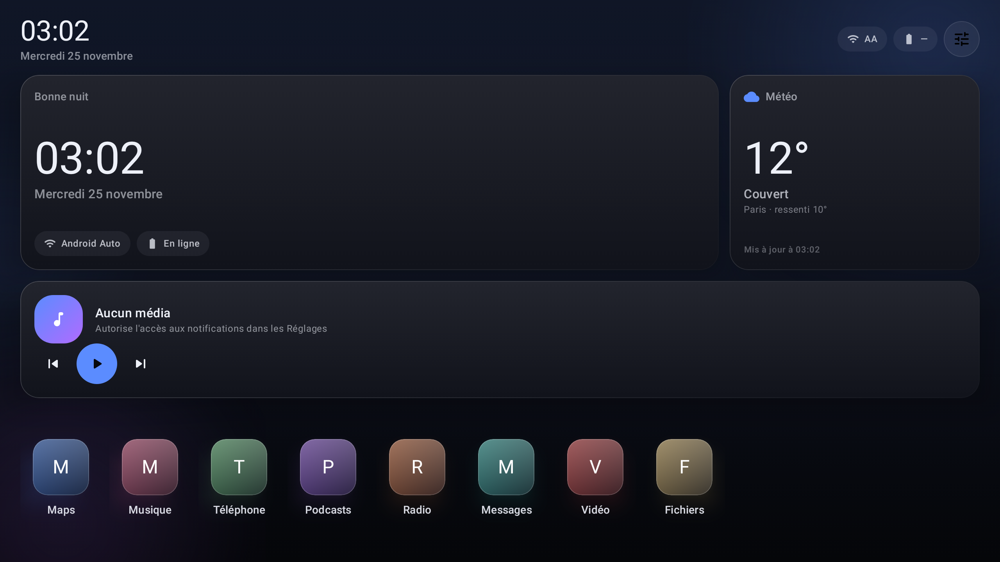
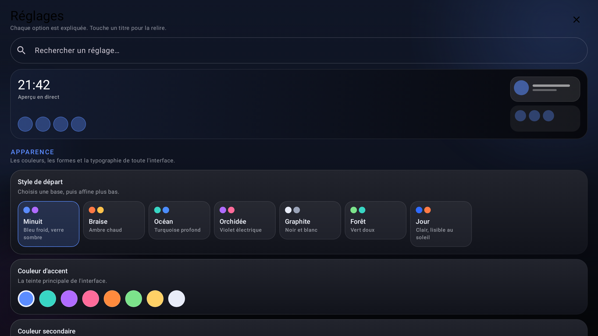
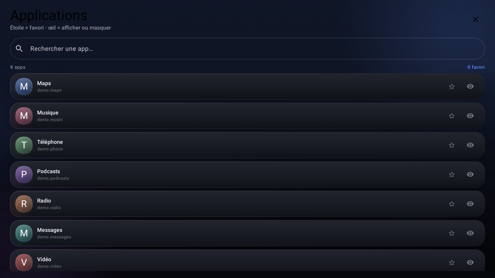
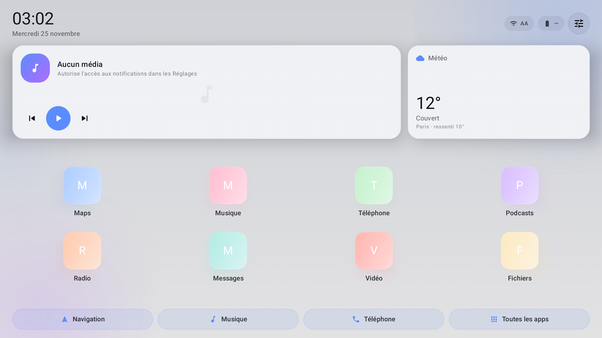
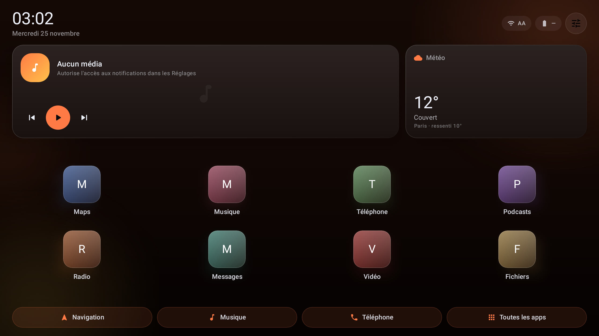

# Car Studio

**Une interface de voiture que tu dessines toi-même.**

Car Studio est une app Android (Kotlin + Jetpack Compose) pensée pour l'écran de la voiture :
un accueil par widgets, un moteur de thème très poussé, et des réglages expliqués un par un.

> **Ce que ce n'est pas.** Ce n'est pas une copie modifiée de l'app Android Auto de Google.
> Android Auto, côté voiture, n'accepte que des composants signés par Google : on ne peut pas
> la remplacer sur un autoradio d'origine. Voir [`docs/ANALYSE.md`](docs/ANALYSE.md) pour le
> détail honnête de ce qui est possible et de ce qui ne l'est pas.

## Aperçu

| Dock | Split |
| --- | --- |
|  |  |

| Focus | Réglages |
| --- | --- |
|  |  |

| Applications | Mode jour | Thème Braise |
| --- | --- | --- |
|  |  |  |

Ces images sont générées par les tests, à partir du vrai code Compose
(`./gradlew recordRoborazziDebug`).

## Où l'app tourne

| Contexte | Ça marche ? | Comment |
|---|---|---|
| Autoradio Android (aftermarket) ou Android Automotive (AAOS) | Oui, nativement | Installer l'APK, la définir comme accueil |
| Téléphone rooté + autoradio d'origine | Oui, via miroir d'écran | Une app de miroir (type Screen2Auto / ScreenOnAuto / KM Auto) affiche Car Studio en plein écran sur l'écran AA |
| Autoradio d'origine sans root | Non | Android Auto n'affichera que les apps qui implémentent ses modèles (media, messagerie, navigation) |
| Raspberry Pi + Crankshaft / OpenAuto | Oui (côté récepteur ouvert) | Ces récepteurs acceptent un certificat non-Google |

## Ce qu'il y a dedans (v0.2)

- **Moteur de thème** : accent, secondaire, fond, surface, rayon des angles, intensité du halo,
  échelle de l'interface, police, forme des icônes, dégradé on/off, fond d'écran, style d'horloge.
- **3 accueils** : `Dock` (média + grille), `Split` (colonne info + grille), `Focus` (tableau de bord).
- **Météo réelle et légère** : Open-Meteo, ville mémorisée, cache, intervalle réglable,
  option « Wi-Fi uniquement » pour ne pas consommer les données mobiles.
- **Média réel** : titre, artiste, pochette et contrôles via `MediaSession`
  (YouTube Music, Spotify, VLC…). L'accès aux notifications est demandé explicitement.
- **Toutes les apps installées** : chargement via `PackageManager`, couleur dominante extraite
  de chaque icône. Écran **Applications** : étoile = favori, œil = afficher / masquer.
- **Mode démo** : des apps factices pour juger le rendu sans voiture.
- **Réglages** : chaque option a un titre et une explication. Recherche, aperçu en direct,
  export / import du thème en JSON, réinitialisation.
- **Mode conduite** : verrouillage des interactions en roulant, grosses cibles tactiles,
  réduction des animations, gaucher / droitier, jour / nuit / auto.
- **Interface adaptative** : paysage large, portrait, split-screen, toutes densités.

## Compiler

```bash
# JDK 21 + Android SDK (compileSdk 35) + Gradle 8.9
gradle assembleDebug
# APK : app/build/outputs/apk/debug/app-debug.apk
```

Un workflow GitHub Actions (`.github/workflows/build.yml`) compile l'APK à chaque push et le
publie en artefact.

## Tester

```bash
# tests logiques (météo, sérialisation, compatibilité des réglages)
gradle testDebugUnitTest --tests "com.carstudio.app.LogicTest"

# captures d'écran réelles des 6 écrans (Roborazzi + Robolectric, sans émulateur)
gradle recordRoborazziDebug
# PNG : app/build/screenshots/
```

## Structure

```
app/src/main/java/com/carstudio/app/
├── MainActivity.kt
├── CarState.kt              # état + persistance + apps visibles
├── data/                    # réglages, thèmes, apps, météo, média, démo
├── media/                   # service d'accès aux sessions média
└── ui/
    ├── CarStudioApp.kt      # navigation accueil / réglages / apps
    ├── HomeScreen.kt        # les 3 accueils + cartes + grille
    ├── SettingsScreen.kt    # réglages expliqués + aperçu + import/export
    ├── AppPickerScreen.kt   # favoris et apps masquées
    ├── theme/CarTheme.kt    # thème dynamique
    └── components/          # verre, halos, tuiles d'app, contrôles
```

## Améliorer le design

Le système de design, les tokens, les captures et un prompt prêt à copier-coller sont dans
[`docs/DESIGN_BRIEF.md`](docs/DESIGN_BRIEF.md). C'est le fichier à donner à ChatGPT ou à un
designer pour faire évoluer le rendu sans casser l'app.

## Feuille de route

Voir [`docs/ROADMAP.md`](docs/ROADMAP.md).

## Licence

MIT. Projet personnel, non affilié à Google. « Android Auto » est une marque de Google LLC.
